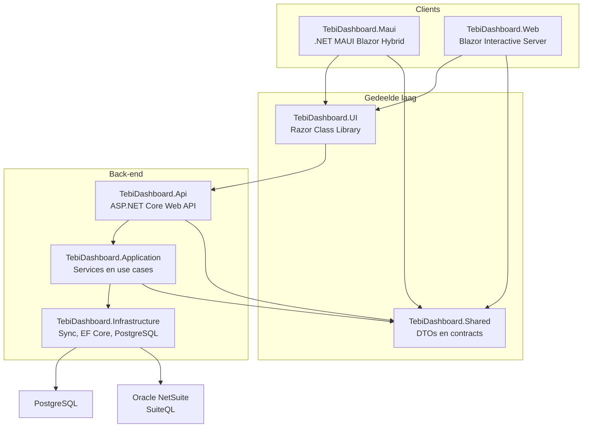
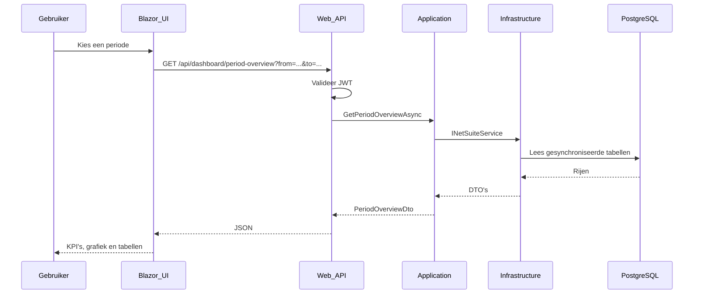
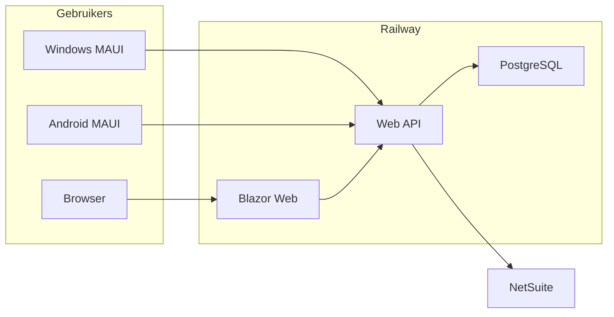

# Architectuur — TEBI Dashboard

Visueel overzicht van de solution-structuur, lagen en datastroom. Bijgewerkt november 2026.

---

## Solution-overzicht



Een pagina leest PostgreSQL. NetSuite wordt aangeroepen tijdens een admin-sync, niet bij elke filterwijziging.

---

## Laagverantwoordelijkheden

### TebiDashboard.Maui

- .NET MAUI host met `BlazorWebView`
- Targets: Windows en Android. Geen iOS-target
- API-basis-URL in `MauiProgram.cs` (`https://localhost:7119/` en `https://10.0.2.2:7119/`)
- Camera-scan via `BarcodeScannerService` en ZXing
- **Geen** businesslogica of NetSuite-credentials

### TebiDashboard.Web

- Blazor Web App, Interactive Server
- Zelfde UI-componenten als MAUI via de gedeelde library
- Browser-toegang, lokaal en op Railway

### TebiDashboard.UI

- Razor-pagina's: dashboard, doelen, klanten, leveranciers, uitgaven, voorraad, bestsellers
- `DashboardApiClient` voor de API-aanroepen
- Eigen CSS en grafiekcomponenten

### TebiDashboard.Shared

- DTO's: `RevenueDto`, `GoalDto`, `DashboardSummaryDto`, `ExpenseDto`, `InventoryItemDto`
- Filters, rollen en periode-helpers
- Geen framework-afhankelijkheden

### TebiDashboard.Api

- REST-controllers
- JWT-authenticatie en rolgebaseerde autorisatie
- CORS voor de geconfigureerde web-origins
- OpenAPI op `/openapi/v1.json` in Development

### TebiDashboard.Application

- `DashboardService` aggregeert KPI's via `INetSuiteService`
- Verder: `IPeriodReportService`, `INetSuiteSyncService`, `IGoalStore`
- Geen NetSuite-HTTP in deze laag

### TebiDashboard.Infrastructure

- `NetSuiteRestClient` en `NetSuiteOAuth2TokenProvider` voor de sync
- `NetSuiteSyncService` schrijft SuiteQL-resultaten naar EF Core
- `DatabaseNetSuiteService` leest die tabellen voor de pagina's
- `MockNetSuiteService` alleen bij `Database:Provider=InMemory`
- PostgreSQL in ontwikkeling en op Railway. SQLite blijft als legacy provider

---

## Datastroom



De sync is een aparte stroom: een admin start `POST /api/netsuite/sync`. Infrastructure haalt SuiteQL op en schrijft de database. Daarna zien de pagina's de nieuwe rijen.

---

## Projectreferenties

```
TebiDashboard.Api
  → TebiDashboard.Application
  → TebiDashboard.Infrastructure
  → TebiDashboard.Shared

TebiDashboard.Application
  → TebiDashboard.Shared

TebiDashboard.Infrastructure
  → TebiDashboard.Application
  → TebiDashboard.Shared

TebiDashboard.UI
  → TebiDashboard.Shared

TebiDashboard.Maui
  → TebiDashboard.UI
  → TebiDashboard.Shared

TebiDashboard.Web
  → TebiDashboard.UI
  → TebiDashboard.Shared
```

Solution-bestand: `src/TebiDashboard.slnx`. `src/TebiDashboard.slnf` sluit MAUI uit.

---

## Deployment



| Component | Hosting |
|-----------|---------|
| Web API | Railway, `Dockerfile.api` |
| Blazor Web | Railway, `Dockerfile.web` |
| Database | PostgreSQL op Railway, lokaal via Docker |
| MAUI | Nog lokaal. MSIX en APK zijn niet gepubliceerd |

Zie [hosting.md](./hosting.md).

---

## Beslissingenlog

| Datum | Beslissing | Reden |
|-------|------------|-------|
| 2026-06 | MAUI + Blazor Hybrid naast web | Schoolopdracht + native mobile |
| 2026-06 | Clean Architecture | Modulair en testbaar |
| 2026-11 | Eigen UI, geen MudBlazor | De pagina's zijn eigen Razor en CSS |
| 2026-11 | Sync naar PostgreSQL, pagina's lezen de database | Een filterwijziging doet geen NetSuite-call |
| 2026-11 | OAuth 2.0 met certificaat-JWT | Machine-to-machine voor SuiteQL |
| 2026-11 | Geen iOS-target | Demo is Windows + Android |

Zie ook de ADR's in [ONTWERP.md](./ONTWERP.md).
