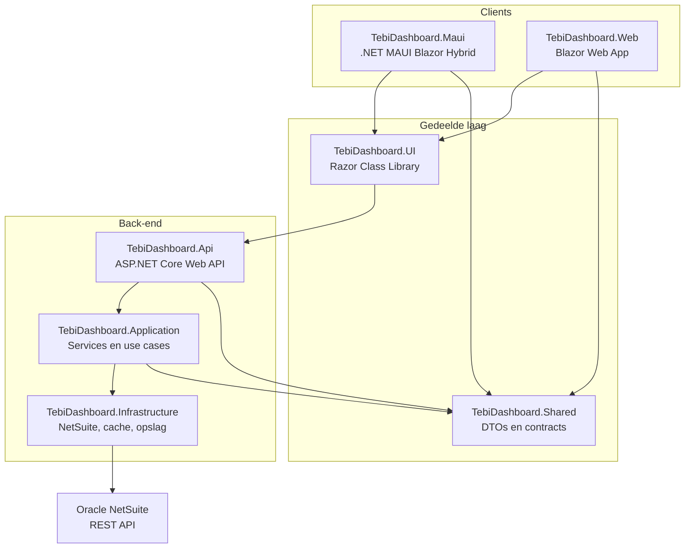
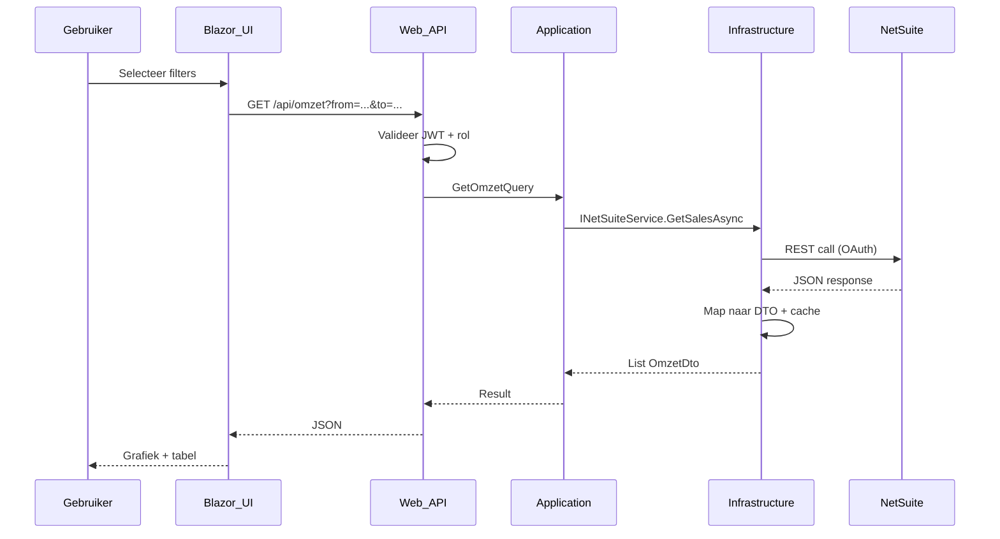
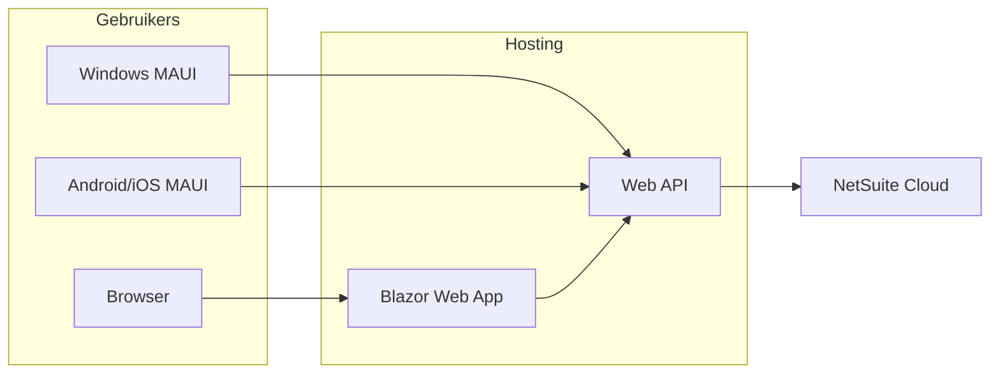

# Architectuur — TEBI Dashboard

Visueel overzicht van de solution-structuur, lagen en datastroom.

---

## Solution-overzicht



---

## Laagverantwoordelijkheden

### TebiDashboard.Maui

- .NET MAUI host met `BlazorWebView`
- Platform-specifieke configuratie (Windows, Android, iOS)
- API-base-URL via app settings
- **Geen** businesslogica of NetSuite-koppeling

### TebiDashboard.Web

- Blazor Web App (Server of WebAssembly — keuze bij implementatie)
- Zelfde UI-componenten als MAUI via gedeelde library
- Browser-toegang (Must have: web-based)

### TebiDashboard.UI

- Razor-components: dashboards, grafieken, filters, layout
- HttpClient-services voor API-aanroepen
- MudBlazor (of vergelijkbaar) voor UI-componenten

### TebiDashboard.Shared

- DTO's: `OmzetDto`, `AfzetDto`, `DoelDto`, `DashboardSummaryDto`
- Filter-modellen en API-contract interfaces
- Geen framework-afhankelijkheden

### TebiDashboard.Api

- REST-controllers
- JWT-authenticatie en autorisatie
- Middleware: CORS, rate limiting, exception handling
- Swagger/OpenAPI

### TebiDashboard.Application

- Use cases: `GetOmzetQuery`, `GetDashboardSummaryQuery`
- Interfaces: `INetSuiteService`, `IDashboardService`
- Validatie en mapping-logica

### TebiDashboard.Infrastructure

- `NetSuiteHttpClient` — OAuth-signed requests naar NetSuite
- `IMemoryCache` implementatie
- Optioneel: EF Core + SQLite/SQL Server voor snapshots
- User Secrets / configuratie voor credentials

---

## Datastroom



---

## Projectreferenties

```
TebiDashboard.Api
  → TebiDashboard.Application
  → TebiDashboard.Infrastructure
  → TebiDashboard.Shared

TebiDashboard.Application
  → TebiDashboard.Shared

TebiDashboard.Infrastructure
  → TebiDashboard.Application
  → TebiDashboard.Shared

TebiDashboard.UI
  → TebiDashboard.Shared

TebiDashboard.Maui
  → TebiDashboard.UI
  → TebiDashboard.Shared

TebiDashboard.Web
  → TebiDashboard.UI
  → TebiDashboard.Shared
```

---

## Deployment (gepland)



| Component | Hosting optie |
|-----------|----------------|
| Web API | Azure App Service / IIS / Docker |
| Blazor Web | Azure Static Web Apps / App Service |
| MAUI | MSIX (Windows), APK/AAB (Android), App Store (iOS) |

---

## Beslissingenlog

| Datum | Beslissing | Reden |
|-------|------------|-------|
| 2026-06 | MAUI + Blazor Hybrid i.p.v. alleen web | Schoolopdracht + native mobile |
| 2026-06 | MudBlazor voor UI | Gratis, goede chart-ondersteuning |
| 2026-06 | Clean Architecture | Modulair, testbaar (adviesrapport) |

Zie ook ADR's in [ONTWERP.md](./ONTWERP.md).
